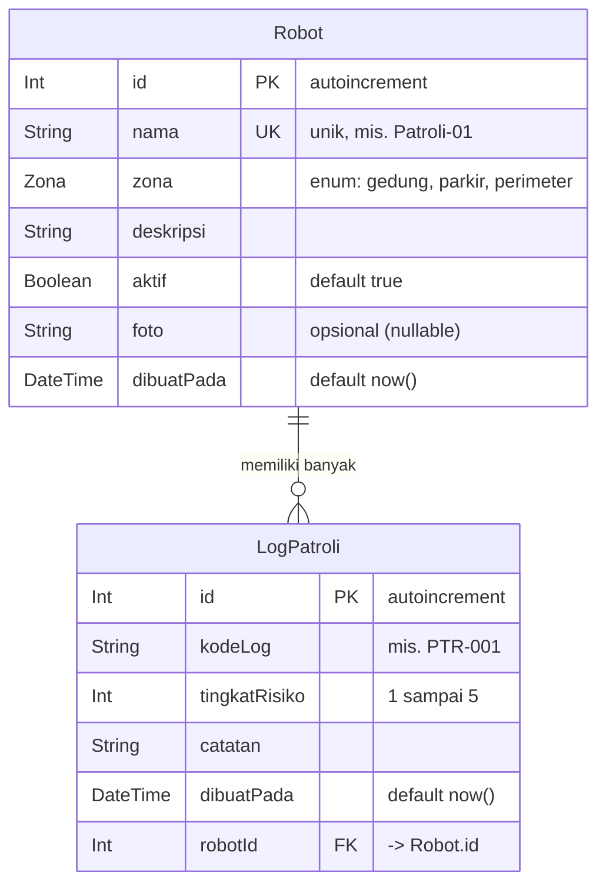

# Dokumen Teknis Modul 6 — PostgreSQL dan Prisma ORM

**Produk:** Rancangan Bangun Dashboard Web Robot Patroli Keamanan

Nama/NIM :Muhammad Fadhilah Chandra Mulan /105224036
Repositori : https://github.com/fadhillahlalalalala-afk/Rancangan_Bangun_Dashboard_Web_Robot_Patroli_Keamanan/edit/main/docs/praktikum/modul-06.md
Pull request : 


## 1. Rancangan Data

### 1.1 Diagram dua entitas



### 1.2 Relasi, kunci, dan constraint

| Aspek | Rancangan |
|---|---|
| Relasi | Satu-ke-banyak (1:N): satu `Robot` memiliki banyak `LogPatroli`. |
| Primary key | `Robot.id` dan `LogPatroli.id` (`@id @default(autoincrement())`). |
| Foreign key | `LogPatroli.robotId` → `Robot.id`. Foreign key berada di tabel pihak "banyak". |
| Unik tunggal | `Robot.nama` (`@unique`) agar satu robot tidak terdaftar dua kali di dashboard. |
| Unik gabungan | `@@unique([robotId, kodeLog])` agar satu robot tidak memiliki dua log dengan kode yang sama. |
| Kolom opsional | `Robot.foto String?` (tanpa `NOT NULL`, bernilai `null` bila robot belum memiliki foto). |
| Aturan hapus | `onDelete: Restrict`. |

### 1.3 Alasan pemilihan aturan `onDelete: Restrict`

Saya memilih **Restrict** dibanding Cascade atau SetNull dengan alasan berikut:

1. **Log patroli adalah rekam jejak keamanan.** Log berisi tingkat risiko dan catatan temuan, yang dapat dibutuhkan untuk audit atau investigasi insiden. Dengan Cascade, satu klik "Hapus robot" dapat menghapus seluruh riwayat patroli robot itu tanpa disadari. Restrict memaksa penghapusan log terjadi secara sadar dan tercatat di kode.
2. **SetNull tidak masuk akal secara data.** `LogPatroli.robotId` bersifat wajib (`Int`, bukan `Int?`). Log tanpa robot tidak diketahui sumbernya, sehingga nilainya sebagai bukti patroli hilang.
3. **Penghapusan menjadi eksplisit melalui transaksi.** Karena basis data menolak penghapusan robot yang masih memiliki log, aplikasi harus menghapus log terlebih dahulu lalu robot, dalam satu transaksi atomik (lihat Bagian 5). Efek samping tersembunyi dari Cascade pun dihindari.
4. **Pengaman terakhir di level basis data.** Walaupun ada bug di kode dashboard, PostgreSQL tetap menolak pelanggaran integritas referensial dengan `ON DELETE RESTRICT`.

Pilihan ini juga menjadi dasar untuk Modul 10–12: ketika autentikasi ditambahkan, pemeriksaan hak akses (misalnya hanya admin yang boleh menghapus robot) dapat dilakukan sebelum transaksi hapus dijalankan.

---

## 2. Skema dan Migrasi

### 2.1 Isi `prisma/schema.prisma`

```prisma
generator client {
  provider = "prisma-client"
  output   = "../generated/prisma"
}

datasource db {
  provider = "postgresql"
}

enum Zona {
  gedung
  parkir
  perimeter
}

model Robot {
  id          Int          @id @default(autoincrement())
  nama        String       @unique
  zona        Zona
  deskripsi   String
  aktif       Boolean      @default(true)
  foto        String?
  dibuatPada  DateTime     @default(now())
  logPatroli  LogPatroli[]
}

model LogPatroli {
  id            Int      @id @default(autoincrement())
  kodeLog       String
  tingkatRisiko Int
  catatan       String
  dibuatPada    DateTime @default(now())
  robotId       Int
  robot         Robot    @relation(fields: [robotId], references: [id], onDelete: Restrict)

  @@unique([robotId, kodeLog])
}
```

Field `logPatroli` dan `robot` adalah field relasi yang hanya ada di level Prisma. Kolom yang benar-benar ada di tabel adalah `robotId`. URL koneksi tidak ditulis di blok `datasource` karena pada Prisma 7 URL diatur di `prisma.config.ts` melalui `DATABASE_URL` (tidak di-commit).

### 2.2 Perintah migrasi dan `generate`

```bash
npx prisma migrate dev --name init
# Applying migration `20261016..._init`
# Your database is now in sync with your schema.

npx prisma generate
# Generated Prisma Client (7.x) to ./generated/prisma
```


`migrate dev` dan `generate` dijalankan **terpisah** karena Prisma 7 tidak lagi menjalankan `generate` maupun seed otomatis setelah `migrate dev`.

### 2.3 Daftar folder `prisma/migrations`

```
prisma/migrations/
├── 20261016XXXXXX_init/
│   └── migration.sql
└── migration_lock.toml
```


Folder migrasi **di-commit** ke repository dan tidak diedit setelah diterapkan. Perubahan skema berikutnya dibuat sebagai migrasi baru.

### 2.4 Potongan `migration.sql`

```sql
-- CreateEnum
CREATE TYPE "Zona" AS ENUM ('gedung', 'parkir', 'perimeter');

-- CreateIndex
CREATE UNIQUE INDEX "Robot_nama_key" ON "Robot"("nama");

-- CreateIndex
CREATE UNIQUE INDEX "LogPatroli_robotId_kodeLog_key" ON "LogPatroli"("robotId", "kodeLog");

-- AddForeignKey
ALTER TABLE "LogPatroli" ADD CONSTRAINT "LogPatroli_robotId_fkey"
  FOREIGN KEY ("robotId") REFERENCES "Robot"("id")
  ON DELETE RESTRICT ON UPDATE CASCADE;
```

Kesesuaian dengan constraint yang dirancang:

| Constraint | Atribut Prisma | Hasil di PostgreSQL |
|---|---|---|
| Primary key | `@id @default(autoincrement())` | Kolom `SERIAL`, `Robot_pkey` / `LogPatroli_pkey` |
| Unik | `@unique` | Indeks unik `Robot_nama_key` |
| Unik gabungan | `@@unique([robotId, kodeLog])` | Indeks unik `LogPatroli_robotId_kodeLog_key` |
| Foreign key | `@relation(fields: [robotId], references: [id])` | Constraint `LogPatroli_robotId_fkey` |
| Aturan hapus | `onDelete: Restrict` | `ON DELETE RESTRICT` |
| Kolom opsional | `String?` | Kolom tanpa `NOT NULL` |

### 2.5 Tangkapan layar `\d` hasil psql

Perintah:

```bash
docker exec -it pg-praktikum psql -U praktikum -d produk -c '\d "LogPatroli"'
```


![Hasil \d "LogPatroli" di psql]

Sebagai referensi, keluaran teks yang diharapkan:

```
Indexes:
    "LogPatroli_pkey" PRIMARY KEY, btree (id)
    "LogPatroli_robotId_kodeLog_key" UNIQUE, btree ("robotId", "kodeLog")
Foreign-key constraints:
    "LogPatroli_robotId_fkey" FOREIGN KEY ("robotId") REFERENCES "Robot"(id) ON UPDATE CASCADE ON DELETE RESTRICT
```

---

## 3. Seed dan Prisma Client

### 3.1 Keluaran `npx prisma db seed` yang dijalankan dua kali

```bash
npx prisma db seed
# Seed selesai: 6 robot, 6 log patroli

npx prisma db seed
# Seed selesai: 6 robot, 6 log patroli
```

Jumlah tetap sama pada eksekusi pertama dan kedua. Ini membuktikan seed tidak menggandakan data.

**Mengapa seed dapat dijalankan ulang?** Seed memakai `upsert`:

```ts
const robot = await prisma.robot.upsert({
  where: { nama: data.nama },        // memakai kolom @unique
  update: {},                        // data yang sudah ada tidak diubah
  create: data,
});

await prisma.logPatroli.upsert({
  where: { robotId_kodeLog: { robotId: robot.id, kodeLog: "LOG-UJI" } }, // unik gabungan
  update: {},
  create: { robotId: robot.id, kodeLog: "LOG-UJI", tingkatRisiko: 2,
            catatan: "Log sintetis untuk pengujian." },
});
```

`upsert` mencari baris berdasarkan constraint unik (`nama` robot dan pasangan `robotId` + `kodeLog`). Bila ditemukan, tidak ada yang dibuat (`update: {}`), dan bila tidak ditemukan, baris baru dibuat. Seed dengan `create` biasa akan gagal pada eksekusi kedua dengan galat **P2002** (pelanggaran constraint unik). Seed hanya berisi data **sintetis**, tanpa data patroli atau lokasi nyata.

### 3.2 Alasan seed tidak mengimpor `lib/prisma.ts`

1. `lib/prisma.ts` memuat `import "server-only"`. Seed dijalankan lewat `tsx` di luar Next.js, sehingga impor ini menyebabkan seed gagal dengan galat terkait `server-only`.
2. `lib/prisma.ts` mengandalkan Next.js untuk memuat `.env`, sedangkan seed berjalan di luar Next.js dan harus memuatnya sendiri lewat `import "dotenv/config"`.
3. Seed adalah proses CLI singkat yang membuat koneksi sendiri (`new PrismaClient({ adapter: new PrismaPg(...) })`) dan memutusnya di `finally` dengan `$disconnect()`. Cache `globalThis` untuk hot reload tidak diperlukan di sini.

Karena itu, seed membuat `PrismaClient` sendiri dan mengimpor data dari `prisma/data-awal.ts`, bukan dari `lib/data.ts`.

### 3.3 Instans Prisma Client untuk aplikasi (`lib/prisma.ts`)

Instans dibuat sekali dan disimpan di `globalThis` pada mode pengembangan, karena hot reload memuat ulang modul berkali-kali dan setiap instans baru membuka pool koneksi baru. Baris `import "server-only"` membuat build gagal bila berkas ini tidak sengaja diimpor ke Client Component, sehingga kredensial basis data tidak bocor ke browser.

---

## 4. Operasi CRUD

### 4.1 Tabel operasi

| Entitas | Aksi / Halaman | Operasi | Metode Prisma Client | Galat yang ditangani |
|---|---|---|---|---|
| Robot | Halaman `/katalog` (daftar robot, Server Component) | Read (daftar) | `robot.findMany` (`select`, `orderBy`) | — |
| Robot | Halaman `/katalog/[id]` (detail robot + log) | Read (detail + relasi) | `robot.findUnique` dengan `select` bertingkat `logPatroli` | Hasil `null` → `notFound()` (404) |
| Robot | Server Action `tambahRobot` | Create | `robot.create` | P2002 → "Nama robot sudah terdaftar" |
| Robot | Server Action `ubahRobot` | Update | `robot.update` | P2002 → "Nama robot sudah terdaftar"; P2025 → "Robot tidak ditemukan atau sudah dihapus." |
| Robot | Server Action `hapusRobot` | Delete (transaksi) | `$transaction([logPatroli.deleteMany, robot.delete])` | P2025 → rollback seluruh transaksi |
| LogPatroli | Server Action `tambahLog` | Create | `logPatroli.create` dengan `robotId` | P2002 → "Kode log ini sudah dicatat untuk robot ini"; P2003 → "Robot tidak ditemukan." |
| LogPatroli | Server Action `hapusLog` | Delete | `logPatroli.deleteMany({ where: { id, robotId } })` | `deleteMany` mengembalikan `count`, tidak melempar galat |
| Robot (seed) | `prisma/seed.ts` | Create/Upsert | `robot.upsert`, `logPatroli.upsert` | — |

### 4.2 Catatan keputusan implementasi

- **Read di Server Component:** Query dipanggil langsung dengan `await`, tanpa `useEffect` dan tanpa endpoint API. `select` membatasi kolom yang dikirim ke Client Component daftar robot.
- **Hindari N+1:** Log patroli dimuat bersama robot dalam satu pemanggilan (`select` bertingkat), bukan query terpisah di dalam `map` untuk tiap robot.
- **Validasi berlapis:** Zod di Server Action memberi pesan ramah dan mencegah query yang tidak perlu (mis. `tingkatRisiko` di luar 1–5). Constraint di basis data menjadi pengaman terakhir.
- **Penerjemahan galat Prisma:** Hanya kode yang diharapkan (P2002, P2003, P2025) yang diterjemahkan menjadi pesan aman. Galat lain dilempar ulang (`throw e`) agar ditangani `error.tsx`. Pesan mentah Prisma tidak ditampilkan ke pengguna dashboard karena memuat nama tabel dan constraint.
- **`hapusLog` memakai `deleteMany` dengan `id` dan `robotId`:** log hanya terhapus bila benar milik robot yang sedang dibuka, dan tidak melempar P2025 bila sudah terhapus.
- **`redirect` di luar `try`:** `redirect` bekerja dengan melempar exception khusus Next.js sehingga tidak boleh tertangkap oleh `catch`.
- **`connection()` dan `loading.tsx`:** halaman dibaca saat ada permintaan (bukan saat `next build`) sehingga dashboard selalu menampilkan data terbaru, dan `app/katalog/loading.tsx` menjadi batas Suspense.

### 4.3 Tangkapan layar pesan galat di formulir

**P2002 — nama robot ganda (create/update):**

![Pesan P2002 di formulir tambah robot]

**P2025 — mengubah robot yang sudah dihapus:**

![Pesan P2025 di formulir ubah robot]


---

## 5. Transaksi dan Rollback

### 5.1 Galat saat menghapus tanpa transaksi (RESTRICT)

Kode sementara di `hapusRobot`:

```ts
await prisma.robot.delete({ where: { id } });
```

Hasil saat menghapus robot yang masih memiliki log patroli: basis data menolak penghapusan karena `ON DELETE RESTRICT`, lalu galat foreign key ditangkap `error.tsx`.

```
[ISI: tempel pesan galat dari terminal Anda, mis. PrismaClientKnownRequestError
 dengan kode P2003 / "Foreign key constraint violated on the constraint: `LogPatroli_robotId_fkey`"]
```


Analisis: constraint bekerja sebagai pengaman terakhir. Robot yang masih memiliki riwayat patroli tidak dapat dihapus langsung, sehingga rekam jejak keamanan tidak hilang tanpa disadari.

### 5.2 Solusi: transaksi bentuk larik

```ts
export async function hapusRobot(id: number) {
  await prisma.$transaction([
    prisma.logPatroli.deleteMany({ where: { robotId: id } }),
    prisma.robot.delete({ where: { id } }),
  ]);
  revalidatePath("/katalog");
  redirect("/katalog");
}
```

**Mengapa bentuk larik (`$transaction([...])`) dan bukan bentuk interaktif?**

- Dua perintah (hapus log, hapus robot) **tidak saling bergantung pada hasil query sebelumnya**. Keduanya hanya perlu berjalan berurutan dan atomik.
- Bentuk larik lebih sederhana, tidak membuka klien `tx`, dan transaksinya singkat sehingga baris yang terkunci tidak menahan transaksi lain lama-lama.
- Bentuk interaktif (`$transaction(async (tx) => ...)`) baru dipilih bila keputusan bergantung pada hasil query sebelumnya, misalnya menolak log patroli baru untuk robot yang `aktif = false` (Tantangan Pengayaan).

**Mengapa transaksi diperlukan?** Tanpa transaksi, bila perintah kedua (`robot.delete`) gagal setelah `deleteMany` berhasil, robot tertinggal dengan riwayat patroli yang sudah hilang. Untuk produk keamanan, kehilangan riwayat parsial seperti ini berbahaya karena data tampak lengkap padahal tidak. Transaksi menjamin **semua berhasil atau semua batal**.

### 5.3 Bukti rollback (sebelum dan sesudah pengujian)

Pengujian: perintah kedua diubah sementara menjadi `prisma.robot.delete({ where: { id: id + 100000 } })`. Perintah ini pasti gagal dengan P2025 karena id tidak ada. Setelah itu tombol **Hapus robot** diklik pada robot yang memiliki log patroli.

**Sebelum pengujian:**

```bash
docker exec -it pg-praktikum psql -U praktikum -d produk \
  -c 'SELECT "robotId", COUNT(*) FROM "LogPatroli" GROUP BY "robotId";'
```

```
[ISI: tempel hasil query SEBELUM, mis.
 robotId | count
---------+-------
       1 |     1
       2 |     1
       ...]
```

**Sesudah pengujian (perintah kedua gagal dengan P2025):**

```
[ISI: tempel hasil query SESUDAH — jumlah log robot yang diuji TIDAK berubah]
```

![Bukti rollback]


Kesimpulan: `deleteMany` sudah berjalan, tetapi karena `delete` kedua gagal (P2025), seluruh transaksi di-rollback sehingga jumlah log patroli tidak berubah. Setelah pengujian, `where` dikembalikan menjadi `{ id }`, dan penghapusan normal berhasil: robot beserta log patrolinya hilang dari katalog.

### 5.4 Hasil 10 skenario uji

Ambang lulus = ⌈0,9 × n⌉ = ⌈0,9 × 10⌉ = **9 dari 10 skenario**.

| No | Skenario | Diharapkan | Aktual | Status |
|----|----------|------------|--------|--------|
| 1 | Tambah robot sah | Robot tampil di katalog | [ISI] | [Lulus/Gagal] |
| 2 | Tambah robot dengan nama ganda | Galat kolom nama (P2002) | [ISI] | [Lulus/Gagal] |
| 3 | Tambah robot dengan nama kosong | Galat Zod, tidak ada query | [ISI] | [Lulus/Gagal] |
| 4 | Ubah deskripsi robot | Tersimpan, tampil di detail | [ISI] | [Lulus/Gagal] |
| 5 | Ubah robot yang sudah dihapus | Pesan tidak ditemukan (P2025) | [ISI] | [Lulus/Gagal] |
| 6 | Buka `/katalog/abc` | Halaman 404 | [ISI] | [Lulus/Gagal] |
| 7 | Hapus robot beserta log patrolinya | Robot dan log hilang | [ISI] | [Lulus/Gagal] |
| 8 | Hapus robot, perintah kedua gagal | Rollback, log patroli tetap ada | [ISI] | [Lulus/Gagal] |
| 9 | Tambah log dengan tingkat risiko 6 | Galat Zod kolom tingkat risiko | [ISI] | [Lulus/Gagal] |
| 10 | Log kedua dengan kode sama pada robot yang sama | Galat kolom kode log (P2002) | [ISI] | [Lulus/Gagal] |

**Persentase kelulusan:** [ISI jumlah lulus] / 10 = [ISI]% → [memenuhi / belum memenuhi] ambang 90%.
---

## 7. Kendala dan Penyelesaian

| No | Kendala | Penyebab | Penyelesaian |
|----|---------|----------|--------------|
| 1 | [ISI, mis. `Module not found: Can't resolve '@/generated/prisma/client'`] | `npx prisma generate` belum dijalankan (Prisma 7 tidak menjalankannya otomatis setelah `migrate dev` / `git clone`). | Menjalankan `npx prisma generate`, memastikan `output` di skema `../generated/prisma`, lalu memulai ulang `npm run dev`. |
| 2 | [ISI, mis. `DATABASE_URL` tidak ditemukan saat menjalankan perintah Prisma] | `.env` tidak dimuat karena `prisma.config.ts` belum mengimpor `dotenv/config`. | Menambahkan `import "dotenv/config";` pada baris pertama `prisma.config.ts`. |
| 3 | [ISI, mis. `Uncached data was accessed outside of <Suspense>`] | Halaman membaca basis data tanpa batas Suspense pada proyek dengan `cacheComponents: true`. | Menambahkan `app/katalog/loading.tsx` dan `await connection()` pada halaman. |
| 4 | [ISI, mis. tipe `null` tidak dapat diberikan ke `string \| undefined` pada `foto`] | Kolom opsional dari Prisma bernilai `null`, sedangkan `lib/tipe.ts` masih `foto?: string`. | Mengubah menjadi `foto: string \| null` dan menyesuaikan komponen yang membacanya. |


---

## 8. Catatan Pemanfaatan AI

| Aspek | Keterangan |
|---|---|
| **Alat** | Claude (Anthropic) |
| **Perintah utama (prompt)** | Meminta bantuan menyusun kerangka Dokumen Teknis Modul 6 berdasarkan modul praktikum dan rubrik penilaian, lalu menyesuaikannya dengan tema produk "Dashboard Web Robot Patroli Keamanan" (entitas Robot dan LogPatroli); meminta penjelasan alasan `onDelete: Restrict`, penggunaan `upsert`, dan pemilihan transaksi bentuk larik. |
| **Bagian yang digunakan** | Draf kalimat penjelasan keputusan teknis (Bagian 1.3, 3.1, 3.2, 5.2), struktur tabel (Bagian 4.1 dan 5.4), dan diagram Mermaid (Bagian 1.1). |
| **Bagian yang TIDAK dibantu AI** | Seluruh eksekusi praktikum (menjalankan perintah, kode, migrasi, seed), keluaran terminal, tangkapan layar, hasil aktual 10 skenario, dan bagian Kendala. |
| **Cara verifikasi** | (1) Setiap pernyataan teknis dicocokkan dengan modul praktikum dan dokumentasi resmi Prisma 7 serta PostgreSQL 18. (2) Skema dan constraint dicek langsung di `migration.sql` dan `\d "LogPatroli"` di psql. (3) Perilaku seed, transaksi, dan rollback dibuktikan dengan menjalankannya sendiri dan membandingkan hitungan data sebelum/sesudah. (4) Semua keluaran dan tangkapan layar berasal dari komputer saya sendiri, bukan dari AI. (5) Saya memastikan dapat menjelaskan skema, migrasi, query, dan transaksi pada produk saya tanpa bantuan AI. |

