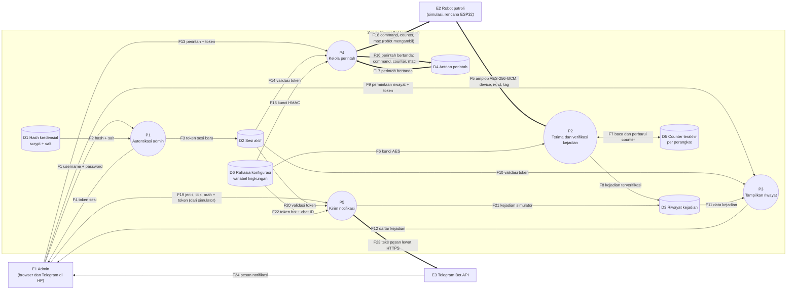

# Diagram Aliran Data (DFD) Awal SecureBot

DFD level 1 untuk versi saat ini. Sumber: `src/app.js`, `src/robotClient.js`, `src/telegram.js`.
ID aset (A-xx) merujuk ke `asset-inventory.md`.

## Legenda
| Simbol | Arti |
|---|---|
| Persegi panjang | External entity (E) |
| Lingkaran | Process (P) |
| Silinder | Data store (D) |
| Garis tebal `==>` | Aliran data yang **dilindungi mekanisme kriptografi** (AES-GCM, HMAC, atau TLS) |
| Garis tipis `-->` | Aliran data tanpa perlindungan kriptografi tingkat aplikasi |

## Diagram

## Tabel aliran data
| ID | Dari | Ke | Data | Protokol | Perlindungan kriptografi | Aset |
|---|---|---|---|---|---|---|
| F1 | E1 Admin | P1 | Username dan password | HTTP `POST /api/login` | Tidak ada di jalur (belum TLS) | A-01 |
| F2 | D1 | P1 | Hash dan salt password | Internal | scrypt | A-02 |
| F3 | P1 | D2 | Token sesi baru (32 byte, berlaku 15 menit) | Internal | CSPRNG | A-03 |
| F4 | P1 | E1 | Token sesi | HTTP | Tidak ada di jalur | A-03 |
| F5 | E2 Robot | P2 | Amplop kejadian `{v, device, iv, ct, tag}` | HTTP `POST /api/events` | **AES-256-GCM**, counter di dalam plaintext | A-05 |
| F6 | D6 | P2 | Kunci AES | Internal (variabel lingkungan) | Dibuat CSPRNG | A-08 |
| F7 | P2 | D5 | Counter terakhir per perangkat (dibaca dan diperbarui hanya setelah dekripsi sukses) | Internal | Tidak ada | A-04 |
| F8 | P2 | D3 | Kejadian terverifikasi | Internal | Tidak ada di penyimpanan | A-04 |
| F9 | E1 | P3 | Permintaan riwayat dan token | HTTP `GET /api/events` | Tidak ada di jalur | A-03 |
| F10 | D2 | P3 | Hasil validasi token | Internal | Tidak ada | A-03 |
| F11 | D3 | P3 | Data kejadian | Internal | Tidak ada | A-04 |
| F12 | P3 | E1 | Daftar kejadian | HTTP | Tidak ada di jalur | A-04 |
| F13 | E1 | P4 | Perintah dan token | HTTP `POST /api/commands` | Tidak ada di jalur | A-06 |
| F14 | D2 | P4 | Hasil validasi token | Internal | Tidak ada | A-03 |
| F15 | D6 | P4 | Kunci HMAC | Internal | Dibuat CSPRNG | A-09 |
| F16 | P4 | D4 | Perintah bertanda `{command, counter, mac}` | Internal | **HMAC-SHA256** | A-06 |
| F17 | D4 | P4 | Perintah bertanda | Internal | **HMAC-SHA256** | A-06 |
| F18 | P4 | E2 Robot | Perintah bertanda | HTTP `GET /api/commands/next` | **HMAC-SHA256**, robot memeriksa MAC dan counter | A-06 |
| F19 | E1 (simulator) | P5 | Jenis kejadian, titik, arah, dan token | HTTP `POST /api/notify` | Tidak ada di jalur | A-04 |
| F20 | D2 | P5 | Hasil validasi token | Internal | Tidak ada | A-03 |
| F21 | P5 | D3 | Kejadian dari simulator | Internal | Tidak ada di penyimpanan | A-04 |
| F22 | D6 | P5 | Token bot dan chat ID | Internal (variabel lingkungan) | Tidak ada | A-11, A-12 |
| F23 | P5 | E3 Telegram | Teks pesan, dengan token bot di URL | HTTPS | **TLS** | A-16 |
| F24 | E3 Telegram | E1 Admin | Pesan notifikasi | Aplikasi Telegram | Mengikuti Telegram | A-16 |

## Batas kepercayaan
| Batas | Memisahkan | Catatan |
|---|---|---|
| TB1 | Browser admin dan server | Saat ini HTTP di `127.0.0.1`; saat dipakai lewat jaringan nyata wajib TLS |
| TB2 | Robot dan server | Lewat WiFi lab yang dianggap tidak tepercaya, sehingga kejadian dan perintah dilindungi kriptografi |
| TB3 | Server dan Telegram | Lewat internet, dilindungi TLS |

## Data yang dilindungi kriptografi (ringkasan)
| Data | Mekanisme | Aliran |
|---|---|---|
| Password admin (tersimpan) | scrypt + salt acak | F2 |
| Kejadian robot | AES-256-GCM + counter | F5 |
| Perintah ke robot | HMAC-SHA256 + counter | F16, F17, F18 |
| Pesan ke Telegram | TLS | F23 |
| Token sesi, kunci, salt, IV | Dibuat dengan CSPRNG | F3, F6, F15 |

## Catatan awal untuk Tugas 1 (celah yang terlihat dari DFD)
1. F1, F4, F9, F13, F19 melintasi TB1 tanpa TLS, sehingga password dan token terlihat jelas di jaringan.
2. F5 dan F18 tidak memakai autentikasi robot terpisah: siapa pun yang mengetahui kunci dapat berperan sebagai robot, dan `GET /api/commands/next` dapat dipanggil siapa saja (isinya hanya berupa perintah bertanda).
3. D1, D2, D3, D4, D5 hanya di memori: tidak ada persistensi, cadangan (A-18), maupun log audit (A-20).
4. Tidak ada pembatasan percobaan login (F1), sehingga password dapat ditebak berulang.
5. Satu kunci bersama untuk semua robot (F6, F15) dan belum ada rotasi.
6. D5 (counter) hilang saat server restart sehingga paket lama dapat diputar ulang.
