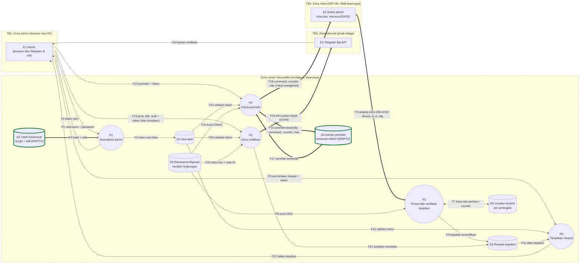

# Diagram Aliran Data (DFD) SecureBot, versi sec-0.1

DFD level 1 untuk produk yang berjalan. Sumber: `src/app.js`, `src/robotClient.js`, `src/telegram.js`.
ID aset (A-xx) merujuk ke `asset-inventory.md`. ID elemen (E, P, D, F, TB) dipakai di `threat-model.md`.

## Perubahan dari Latihan 1
- Trust boundary kini **digambar** sebagai zona di diagram (TB1, TB2, TB3), tidak hanya ditulis di tabel.
- Aset data yang dilindungi kriptografi ditandai dengan garis tebal dan label **[KRIPTO]**, termasuk penyimpanan D1.
- Ditambahkan tabel elemen (E, P, D) dengan endpoint dan aset, serta kolom batas kepercayaan (TB) pada setiap aliran.
- Aset di tabel aliran dan penyimpanan disesuaikan dengan `asset-inventory.md` (A-23 untuk counter D5).

## Legenda
| Simbol | Arti |
|---|---|
| Persegi panjang | External entity (E) |
| Lingkaran | Process (P) |
| Silinder | Data store (D) |
| Kotak zona bernama TBx | Zona kepercayaan. Garis batas zona itu adalah trust boundary TBx |
| Garis tebal `==>` | Aliran data yang **dilindungi mekanisme kriptografi** [KRIPTO] (AES-GCM, HMAC, scrypt, atau TLS) |
| Garis tipis `-->` | Aliran data tanpa perlindungan kriptografi tingkat aplikasi |
| Kotak berbingkai hijau tebal | Penyimpanan yang isinya dilindungi kriptografi [KRIPTO] |

## Diagram

## Tabel elemen
| ID | Jenis | Nama | Endpoint atau lokasi | Aset terkait |
|---|---|---|---|---|
| E1 | External entity | Admin (browser dan Telegram di HP) | Browser ke `http://<server>:3000`; dashboard di `client/`, `web/dashboard.html` | A-01, A-03, A-07, A-14, A-21 |
| E2 | External entity | Robot patroli (simulasi, rencana ESP32) | `src/robotClient.js` | A-05, A-06, A-08, A-09, A-15 |
| E3 | External entity | Telegram Bot API | `api.telegram.org` | A-16 |
| P1 | Process | Autentikasi admin | `POST /api/login` | A-01, A-03, A-21 |
| P2 | Process | Terima dan verifikasi kejadian | `POST /api/events` | A-04, A-05, A-23 |
| P3 | Process | Tampilkan riwayat | `GET /api/events` | A-03, A-04 |
| P4 | Process | Kelola perintah | `POST /api/commands`, `GET /api/commands/next` | A-06, A-09 |
| P5 | Process | Kirim notifikasi | `POST /api/notify`, `src/telegram.js` | A-04, A-11, A-12 |
| D1 | Data store | Hash kredensial **[KRIPTO]** | Memori server | A-02 |
| D2 | Data store | Sesi aktif | Memori server | A-03 |
| D3 | Data store | Riwayat kejadian | Memori server | A-04 |
| D4 | Data store | Antrian perintah **[KRIPTO]** (isi bertanda HMAC) | Memori server | A-06 |
| D5 | Data store | Counter terakhir per perangkat | Memori server | A-23 |
| D6 | Data store | Rahasia konfigurasi | Variabel lingkungan | A-08, A-09, A-10, A-11, A-12 |

Catatan pemetaan aset ke elemen: **A-13** (Backend API) adalah seluruh zona server, yaitu P1 sampai P5 beserta D1 sampai D6. **A-19** (log konsol) adalah keluaran konsol P1 sampai P5. **A-17** dan **A-22** (GitHub dan akunnya) berada di luar DFD runtime karena menyangkut rantai pasokan kode, bukan aliran data produk yang berjalan.

## Tabel aliran data
| ID | Dari | Ke | Data | Protokol | Perlindungan kriptografi | Melintasi | Aset |
|---|---|---|---|---|---|---|---|
| F1 | E1 Admin | P1 | Username dan password | HTTP `POST /api/login` | Tidak ada di jalur (belum TLS) | TB1 | A-01 |
| F2 | D1 | P1 | Hash dan salt password | Internal | **[KRIPTO] scrypt** | - | A-02 |
| F3 | P1 | D2 | Token sesi baru (32 byte, berlaku 15 menit) | Internal | CSPRNG | - | A-03 |
| F4 | P1 | E1 | Token sesi | HTTP | Tidak ada di jalur | TB1 | A-03 |
| F5 | E2 Robot | P2 | Amplop kejadian `{v, device, iv, ct, tag}` | HTTP `POST /api/events` | **[KRIPTO] AES-256-GCM**, counter di dalam plaintext | TB2 | A-05 |
| F6 | D6 | P2 | Kunci AES | Internal (variabel lingkungan) | Dibuat CSPRNG | - | A-08 |
| F7 | P2 | D5 | Counter terakhir per perangkat (dibaca dan diperbarui hanya setelah dekripsi sukses) | Internal | Tidak ada | - | A-23 |
| F8 | P2 | D3 | Kejadian terverifikasi | Internal | Tidak ada di penyimpanan | - | A-04 |
| F9 | E1 | P3 | Permintaan riwayat dan token | HTTP `GET /api/events` | Tidak ada di jalur | TB1 | A-03 |
| F10 | D2 | P3 | Hasil validasi token | Internal | Tidak ada | - | A-03 |
| F11 | D3 | P3 | Data kejadian | Internal | Tidak ada | - | A-04 |
| F12 | P3 | E1 | Daftar kejadian | HTTP | Tidak ada di jalur | TB1 | A-04 |
| F13 | E1 | P4 | Perintah dan token | HTTP `POST /api/commands` | Tidak ada di jalur | TB1 | A-03, A-06 |
| F14 | D2 | P4 | Hasil validasi token | Internal | Tidak ada | - | A-03 |
| F15 | D6 | P4 | Kunci HMAC | Internal | Dibuat CSPRNG | - | A-09 |
| F16 | P4 | D4 | Perintah bertanda `{command, counter, mac}` | Internal | **[KRIPTO] HMAC-SHA256** | - | A-06 |
| F17 | D4 | P4 | Perintah bertanda | Internal | **[KRIPTO] HMAC-SHA256** | - | A-06 |
| F18 | P4 | E2 Robot | Perintah bertanda (robot yang memulai permintaan) | HTTP `GET /api/commands/next` | **[KRIPTO] HMAC-SHA256**, robot memeriksa MAC dan counter | TB2 | A-06 |
| F19 | E1 (simulator) | P5 | Jenis kejadian, titik, arah, dan token | HTTP `POST /api/notify` | Tidak ada di jalur | TB1 | A-03, A-04 |
| F20 | D2 | P5 | Hasil validasi token | Internal | Tidak ada | - | A-03 |
| F21 | P5 | D3 | Kejadian dari simulator | Internal | Tidak ada di penyimpanan | - | A-04 |
| F22 | D6 | P5 | Token bot dan chat ID | Internal (variabel lingkungan) | Tidak ada | - | A-11, A-12 |
| F23 | P5 | E3 Telegram | Teks pesan, dengan token bot di URL | HTTPS | **[KRIPTO] TLS** | TB3 | A-11, A-16 |
| F24 | E3 Telegram | E1 Admin | Pesan notifikasi | Aplikasi Telegram | Mengikuti Telegram | TB3 | A-16 |

## Batas kepercayaan
| Batas | Memisahkan | Aliran yang melintas | Catatan |
|---|---|---|---|
| TB1 | Zona admin (browser dan HP) dan zona server | F1, F4, F9, F12, F13, F19 | Saat ini HTTP di `127.0.0.1`. Saat dipakai lewat jaringan nyata wajib TLS. |
| TB2 | Zona robot dan zona server | F5, F18 | Lewat WiFi lab yang dianggap tidak tepercaya, sehingga kejadian dan perintah dilindungi kriptografi. |
| TB3 | Zona server dan zona internet (Telegram), lanjut ke HP admin | F23, F24 | Lewat internet. F23 dilindungi TLS. Isi pesan dan token bot (di URL) bergantung pada Telegram. |

## Data yang dilindungi kriptografi (ringkasan)
| Data | Mekanisme | Aliran atau penyimpanan | Aset |
|---|---|---|---|
| Password admin (tersimpan) | scrypt + salt acak | D1, F2 | A-02 |
| Kejadian robot | AES-256-GCM + counter | F5 | A-05 |
| Perintah ke robot | HMAC-SHA256 + counter | D4, F16, F17, F18 | A-06 |
| Pesan ke Telegram | TLS | F23 | A-16 |
| Token sesi, kunci, salt, IV | Dibuat dengan CSPRNG (bukan perlindungan saat simpan atau kirim) | F3, F6, F15 | A-03, A-08, A-09 |

## Celah awal yang menjadi masukan threat model
1. F1, F4, F9, F12, F13, F19 melintasi TB1 tanpa TLS, sehingga password dan token terlihat jelas di jaringan.
2. F5 dan F18 (TB2) tidak memakai autentikasi robot terpisah: siapa pun yang mengetahui kunci dapat berperan sebagai robot, dan `GET /api/commands/next` dapat dipanggil siapa saja (isinya hanya berupa perintah bertanda).
3. D1, D2, D3, D4, D5 hanya di memori: tidak ada persistensi, cadangan (A-18), maupun log audit (A-20).
4. Tidak ada pembatasan percobaan login (F1), sehingga password dapat ditebak berulang.
5. Satu kunci bersama untuk semua robot (F6, F15) dan belum ada rotasi.
6. D5 (counter) hilang saat server restart sehingga paket lama dapat diputar ulang (A-23).
